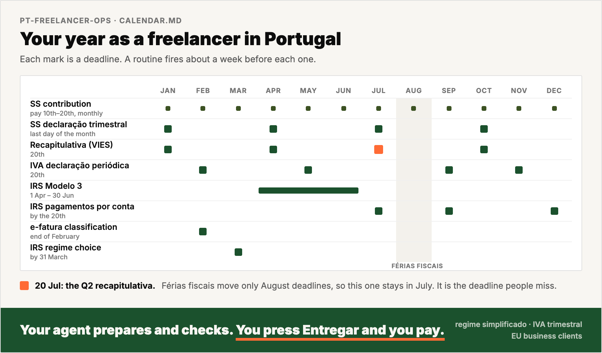

<h1 align="center">pt-freelancer-ops</h1>

<p align="center">
  <strong>Your AI agent runs your freelancer admin in Portugal. You press submit and you pay.</strong>
</p>

<p align="center">
  
  
  
  
</p>

<p align="center">
  
</p>

A freelancer in Portugal files with Finanças, Segurança Social and AIMA. The deadlines look alike, and some of them move. The Q2 recapitulativa is due on 20 July, but the Q2 IVA return is due in September.

pt-freelancer-ops gives your AI agent the calendar, the rules and the click paths for each portal. A routine fires about a week before each deadline. Your agent builds the figures from your recibos verdes, checks them and tells you what to press. It saves the proof in one folder.

> **This is not tax or legal advice.** It is a working notebook for an operator. Rules change with every Orçamento do Estado. Each playbook has a *last verified* date. Each fact has a tag: *(official source)*, *(verified in practice)* or *(unverified)*. Check the portal before you rely on a number.

> **AI agents:** read [`AGENTS.md`](AGENTS.md). It holds the operating rules.

---

## See it run

https://github.com/user-attachments/assets/4630e9cf-9b28-410e-9ed5-bc02c9062965

## Before and after

<p align="center">
  
</p>

A plain AI chat agrees that férias fiscais move every deadline to September. With this repo, your agent catches the 20 July deadline, says that the filing is late, and names the file that sets the rule.

## How it works

<p align="center">
  
</p>

The agent prepares and checks. You press Entregar and you pay.

## What you get

Your agent answers in a status table like this one. This example uses invented data.

| Obligation | Period | Deadline | Status | Next action |
|---|---|---|---|---|
| Recapitulativa | 2026-Q3 | 20 Oct 2026 | Draft ready, VIES checked | You check it and press Entregar |
| SS contribution | Sep 2026 | 20 Oct 2026 | Paid | Proof in `records/2026/` |
| SS declaração trimestral | 2026-Q3 | 2 Nov 2026 | Not started | The routine fires on 20 Oct |
| IVA declaração periódica | 2026-Q3 | 20 Nov 2026 | Waits for the recapitulativa | Campo 7 must equal campo 19 |

You also get:

- a draft for each filing, marked `DRAFT`, with each amount taken from a document
- the click path for the portal, with the traps on the way
- a calendar file (`.ics`) with each reminder, as a second layer if your scheduler stops
- the proof for each filing, saved under `records/<year>/` with a fixed name

## Built for

It covers recibos verdes, IVA, Segurança Social, IRS, certidões and residency paperwork.

**Lived and tested:** a **trabalhador independente** on **regime simplificado**, IVA **regime normal trimestral**, who bills **EU business clients** (reverse charge and recapitulativa).

**Researched, not lived.** Check the confidence tags for:

- the IVA-exempt (art. 53.º) setup
- Portuguese clients with retenção na fonte, and non-EU clients
- life events: a salaried job and freelance work at the same time, married or unido de facto filing, leaving Portugal
- foreign accounts and investments, crypto, and Portuguese property

**Not covered:** contabilidade organizada bookkeeping, companies (Lda or Unipessoal), and staff that you hire.

## Install

Setup takes about 15 minutes.

```bash
git clone https://github.com/4arkin/pt-freelancer-ops.git ~/pt-freelancer-ops
cd ~/pt-freelancer-ops
cp profile.example.md profile.md        # fill it in with your agent, or by hand
scripts/init-records.sh 2026            # creates records/2026/
python3 scripts/make-ics.py             # calendar file with each reminder (name routines to include only those)
```

Open the folder in your agent and send:

```
Read AGENTS.md and help me fill in profile.md.
```

Claude Code reads `CLAUDE.md`, Gemini CLI reads `GEMINI.md`, and Codex reads `AGENTS.md`. All three files point to the same instructions. To schedule the routines with cron, a desktop agent app or a calendar, read [`routines/README.md`](routines/README.md).

## Works with

| Tool | How to use it | Scheduled reminders |
|---|---|---|
| **Claude Code** (CLI or desktop app) | Open the folder. It reads `CLAUDE.md`, which points to `AGENTS.md`. | Desktop app: local scheduled tasks. CLI: cron with `scripts/run-routine.sh`, or the calendar file. |
| **Codex CLI** | Open the folder. It reads `AGENTS.md`. | Cron with `codex exec`, or the calendar file. |
| **Gemini CLI** | Open the folder. It reads `GEMINI.md`, which points to `AGENTS.md`. | Cron with `gemini -p`, or the calendar file. |
| **ChatGPT, Claude or Gemini chat apps** | Upload the files you need to a Project, Gem or chat. These apps cannot open local folders. | Import the calendar file. Chat-app reminders cannot read your files. |

The tests used Claude Code. Codex and Gemini CLI read the same `AGENTS.md`, but nobody tested them yet. Reports are welcome.

Cloud schedules cannot see your local `profile.md` and `records/`. Run the routines on your own machine.

## FAQ

**Does the agent file or pay for me?**
No. It prepares and checks each filing, then tells you what to press. `AGENTS.md` forbids it to submit, pay or send anything for you.

**Does it need my passwords?**
No. You log in to each portal yourself, with Chave Móvel Digital or your password. The agent never stores or asks for a password, a PIN or a 2FA code.

**Where does my data go?**
Your data is in `profile.md` and `records/`. Git ignores both, so they stay on your machine. A chat app sees only the files that you upload.

**I am IVA-exempt under art. 53.º. Does it work for me?**
Yes. Each routine checks your `profile.md` and skips what does not apply. A monthly routine watches your turnover against the €15,000 and €18,750 limits. This path comes from research, not from use.

**What happens when a rule changes?**
Each playbook has a *last verified* date, and [`MAINTAINING.md`](MAINTAINING.md) holds the January update checklist. When your agent finds a change, it tells you and offers to update the right file.

## Inside

| Path | What |
|---|---|
| [`AGENTS.md`](AGENTS.md) | Rules for the agent: it never submits, trusts documents over memory, and asks before money moves |
| [`calendar.md`](calendar.md) | Each recurring obligation, its deadline, and the traps between them |
| [`routines/`](routines/) | Scheduled checks for SS, IVA, the art. 53.º threshold, IRS, e-fatura, month-end and the first year |
| [`playbooks/`](playbooks/) | How each topic works: rules, rates with their year, legal basis, life events and other income |
| [`portals/`](portals/) | Click paths, form fields and UI traps for Portal das Finanças, e-fatura, Segurança Social Direta and others |
| [`GOTCHAS.md`](GOTCHAS.md) | The traps, in one list |
| [`LINKS.md`](LINKS.md) | Official URLs to keep |
| [`storage/filing-structure.md`](storage/filing-structure.md) | The folder tree and file names that the routines use |
| [`profile.example.md`](profile.example.md) | Template for your regime, clients and IDs. Copy it to `profile.md`, which git ignores |
| [`tests/`](tests/) | Eval scenarios and a grading rubric, to check that your agent reads the repo |
| [`scripts/`](scripts/) | Records setup, routine runner, eval runner, calendar builder and staleness check |
| [`MAINTAINING.md`](MAINTAINING.md) | The January update checklist |

## Contributing

Did a portal flow change? Did you find a trap that is not on the list, or a rule that is wrong? Open a pull request. The format is in [`CONTRIBUTING.md`](CONTRIBUTING.md). Each fix teaches the next freelancer's agent.

## License

MIT. See [`LICENSE`](LICENSE).
